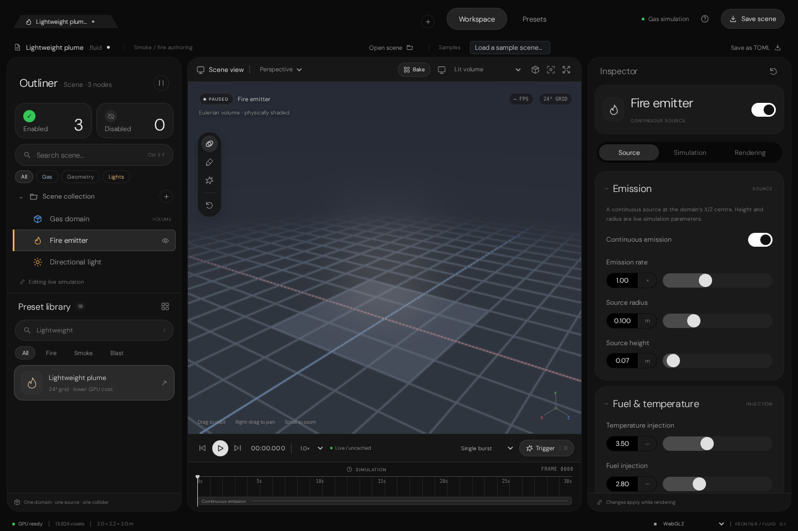

# Fluid Editor source restoration evidence

## Outcome

Copied the existing non-node gas Fluid Editor from the latest inspected branch into `Experimental/Fluid/`; no replacement UI was authored.
The restored prototype exposes plume, detonation/blast, wildfire tornado, and dust tornado presets, source/solver/render controls,
eight TOML sample scenes, and WebGL2 with experimental WebGPU selection.

Source provenance is documented in `Experimental/Fluid/README.md`:

- `SultanAladin/Frontier-`, branch `arena/b5d061d9-frontier`
- copied branch tip `7ff19ee57e11d649aff94d8f0195a4333cfe1a88` (2026-10-14)
- Fluid sample-scene update `f1dfdcf998dfc2831d3ff84bead659a85ddf7f1f`

The Remastered Particle Studio was moved from `Experimental Remastered/EditorInterface/` to
`Experimental Remastered/ParticleEditor/`. Its path links, suite links, and redirect were updated. The separate older
`Experimental/ParticleEditor/` tree was retained because the reference validators and exporter still consume it.

## Verification

| Check | Result |
|---|---|
| Dependency install | `npm ci --no-audit --no-fund` succeeded; Node.js 22.22.3, npm 10.9.8 |
| Production bundle | `npm run build` succeeded with Vite 7.3.6; DM Sans assets bundle from the existing licensed Particle Studio fonts |
| Scene/preset/codec suite | `npm test`: 22 passed, 0 failed |
| Browser/render suite | `npm run verify:browser`: 18 passed, 0 failed |
| Interaction suite | `npm run verify:interactions`: 9 passed, 0 failed |
| Moved and Fluid entry routes | 7 static HTTP routes returned 200 |
| Captured browser image | `Images/Verification-2026-11-09/VerifiedWorkspace.png` |

The browser suites exercised live WebGL2 simulation/rendering, software SwiftShader readback, settings edits, preset loading,
TOML import/export, responsive layout, source/collider manipulation, explosions, camera controls, overlays, and lifecycle behavior.
No browser JavaScript or WebGL errors were recorded.

## Reproduction

From the repository root:

```bash
cd Experimental/Fluid
npm ci --no-audit --no-fund
npm run build
npm test
npm run dev -- --host 0.0.0.0
```

For the retained browser proof, Chromium 153 was installed in ignored scratch with `@sparticuz/chromium@153.0.0`; its bundled
Amazon Linux libraries were exposed through `LD_LIBRARY_PATH`:

```bash
LD_LIBRARY_PATH=/tmp/al2023/lib \
BROWSER_EXECUTABLE=/tmp/chromium \
BROWSER_ARTIFACTS=/home/user/Frontier/Exhibits/FluidEditor/Images/Verification-2026-11-09 \
npm run verify:browser

LD_LIBRARY_PATH=/tmp/al2023/lib \
BROWSER_EXECUTABLE=/tmp/chromium \
npm run verify:interactions
```

A small Python `ThreadingHTTPServer` served the repository root for the seven static-route checks. The application preview itself
is Vite on `0.0.0.0:5173`.

## Evidence image



## Limits

- This is browser prototype execution, not native C++ editor UI.
- Software SwiftShader WebGL is the exercised renderer; the optional WebGPU selection correctly falls back to WebGL2 in this headless environment.
- The restored JavaScript solver is not connected to this checkout's C++ `FluidSpace` or `FluidSimulationSequence`.
- Windows/MSVC and native hardware GPU execution were not run.
- The screenshot shows the actual browser rendering at the end of the verification interactions; it is not a mockup or a native editor capture.
